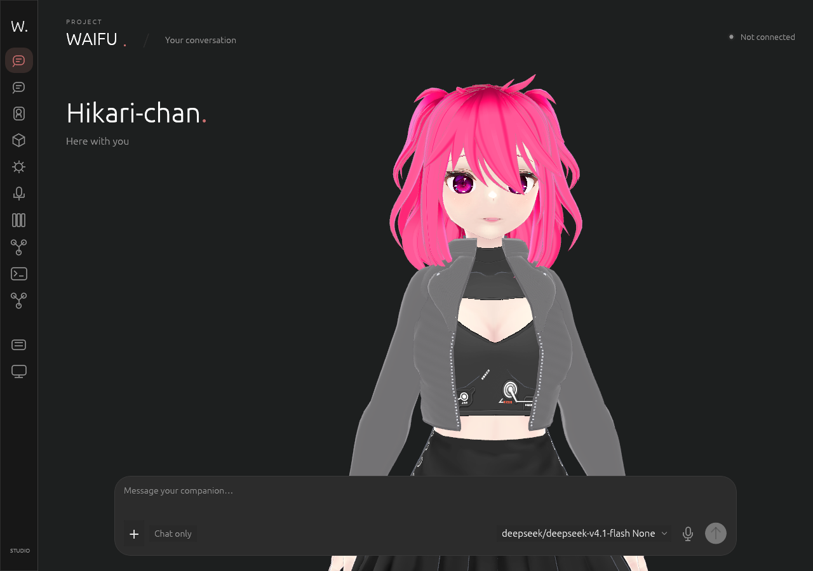

# Waifu Studio

**Your character, your voice, your desktop.**

Waifu Studio is a native desktop companion for Windows and Linux. Choose an avatar, give them a personality and voice, and chat in a full studio or keep them beside you on your desktop. Connect the AI services you use, or point the app at a compatible local model server.

[Download the preview](https://github.com/xsploit/waifu-studio/releases) · [Getting started](docs/PREVIEW.md) · [Report a problem](https://github.com/xsploit/waifu-studio/issues)

> **Early preview.** Windows and Linux builds are available for testing. Expect rough edges, particularly around graphics drivers, desktop behavior and audio devices. The repository is currently private, so downloads require repository access.

## Make a companion your own

**Start with a character.** The preview includes 25 editable character profiles, including Hikari, Riko and Neuro-sama. Hikari has several model variants. Import your own VRM, GLB or glTF model and adjust its appearance, expressions, outlines and spring-bone motion.

**Give each profile its own personality.** Save a character's model, persona, voice, AI provider and scene together. Switch between profiles without mixing their conversations. Hikari, Riko and Neuro-sama include personality templates; the other avatars are ready for you to write your own.

**Chat with text or your microphone.** Replies stream as they arrive. Add images with a vision-capable model, use speech-to-text for microphone input, and enable spoken replies with playback-driven lip-sync. Fish Audio voice browsing and multiple speech delivery modes are available in Voice settings.

**Bring them onto your desktop.** Drag and resize the companion, choose a seat, and open controls with the right-click radial menu. Switch back to Studio for character editing, conversations and settings. Desktop transparency and window interactions depend on your operating system and graphics setup.

**Set the scene.** Use an image background, a color, or one of the furnished 3D rooms. Import BVH, VRMA or FBX animations and adjust playback. Scene conversations can include several characters taking turns.

**Keep useful memories.** Write character-specific notes and review suggested facts or preferences. Optional semantic search and reflection drafts add more ways to recall information; they need their own configuration and review.

<table>
  <tr>
    <td></td>
    <td></td>
  </tr>
  <tr>
    <td align="center">Character and appearance controls</td>
    <td align="center">Furnished 3D scenes</td>
  </tr>
</table>

## Choose your AI and voice

Waifu Studio connects to services; it does not include a hosted AI subscription or a bundled language model.

| For | Available connections |
| --- | --- |
| Chat | Vercel AI Gateway, OpenRouter, OpenAI, xAI and compatible custom endpoints |
| Local chat | Ollama, LM Studio and llama.cpp through their OpenAI-compatible servers |
| Speech | Fish Audio hosted/local, Vercel AI Gateway and OpenAI-compatible speech endpoints |
| Microphone input | A configured transcription endpoint, with voice-activity detection controls |

Supply your own provider credentials or local server address. Cloud providers can charge for usage. Profiles, conversation history and notes are stored on your machine; content sent to a configured service is processed by that service. Local-model performance and compatibility depend on your setup.

Vercel chat and hosted Fish speech have been checked with live requests on the Windows build. Other provider combinations and audio-device setups still need testing. See [connection settings](docs/connection-settings.md) for configuration.

## Get started

1. **Download** the Windows x64 ZIP or Linux x64 tarball from [Releases](https://github.com/xsploit/waifu-studio/releases).
2. **Extract the whole archive.** Keep the executable and `assets/` directory together.
3. **Open Studio:** double-click `studio.cmd` on Windows, or run `./studio.sh` on Linux.
4. **Choose a profile and configure chat.** Select your provider and model in Connections, add your key or server address, and test a short text conversation.
5. **Set up voice if you want it**, then use Desktop mode to bring the companion onto your desktop.

You do not need Rust or a development environment to run the downloads. The setup wizard is planned; this preview uses the existing settings screens.

| Platform | Preview requirements |
| --- | --- |
| Windows | Windows 10/11 x64, current graphics drivers and the Microsoft Visual C++ x64 runtime. The preview is unsigned. |
| Linux | x64; built on Ubuntu 24.04. Requires compatible system libraries and a Vulkan-capable graphics driver. Older distributions have not been validated. |

On Linux, X11/Vulkan opens Studio because transparent desktop rendering is unreliable on that path. Native Wayland/KDE/Hyprland behavior needs broader testing. The larger avatars may exceed software-renderer limits.

Saved data lives in `%LOCALAPPDATA%\waifu-studio\data` on Windows and `~/.local/share/waifu-studio` on Linux. Existing profiles are reused. [Full setup and troubleshooting](docs/PREVIEW.md).

## What to expect from this preview

The core character, chat, voice and scene controls are implemented. Windows and Linux have native builds and automated tests. That does not establish compatibility with every avatar, GPU, compositor, microphone or speaker setup.

- **Desktop and audio testing is ongoing.** Multi-monitor placement, mixed DPI, transparency, lip-sync and long sessions need feedback from more machines.
- **Voice starts from a user action.** Microphone input can send after a silence, but this is not a continuous, full-duplex voice conversation.
- **Advanced integrations are experimental.** Content packs, Twitch/Discord adapters, manual MCP tools and reviewed coding-agent tasks are available in varying stages of completion. Optional integrations can need Python, Node.js, separate runtimes or additional accounts.
- **VR/OpenXR, standalone Quest support and the setup wizard are not included.**

The [feature status](FEATURE-STATUS.md) and [validation notes](VALIDATION.md) distinguish what is implemented from what has actually been tested.

## Help test it

Try a fresh setup, a short conversation, voice playback, Desktop mode, and restarting with saved settings. If something breaks, [open an issue](https://github.com/xsploit/waifu-studio/issues) with the release version, OS, GPU, what you did and what happened. A screenshot or a short error excerpt helps.

## For developers

Built with Rust, Bevy and egui. The repository pins its Rust toolchain. After installing the platform dependencies, run `run.cmd --studio` on Windows or `./run.sh --studio` on Linux.

- [Build from source and platform details](docs/CROSS-PLATFORM.md)
- [Character and scene customization](CUSTOMIZATION.md)
- [Content packs](docs/content-packs.md) and [extension authoring](docs/extension-authoring.md)
- [Streaming capture](docs/streaming-capture.md) and [Twitch setup](docs/twitch-setup.md)
- [Measured pipeline results](benchmarks/RESULTS.md)

## License and credits

Application source is [MIT-licensed](LICENSE). Avatar models retain their individual authorship and terms; the source license does not relicense them. Model metadata is included with the assets.

The desktop motions come from [Desktop Homunculus](https://github.com/not-elm/desktop-homunculus) under CC BY 4.0. Illustrated backgrounds and wall art are AI-generated. See [references and dependency notices](REFERENCES.md) and [lip-sync notices](LIPSYNC-NOTICES.txt) for credits and licenses.
