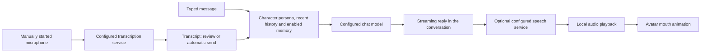
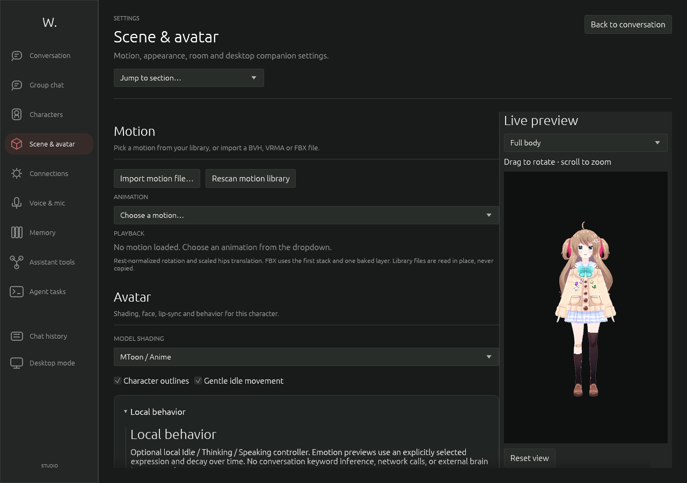

# Waifu Studio

**Your character, your voice, your desktop.**

Waifu Studio is a native desktop companion for Windows and Linux. Build a character from an avatar, a personality and a voice, then talk with them in Studio or keep them beside you on your desktop. Give each character their own conversations and memories, arrange several characters in a scene, and connect the AI services or compatible local servers you want to use.

[Download the preview](https://github.com/xsploit/waifu-studio/releases) · [Setup guide](docs/PREVIEW.md) · [Report a problem](https://github.com/xsploit/waifu-studio/issues)

> **Early preview.** Windows and Linux builds are available for testing. The core companion workflow is implemented; graphics, audio devices, desktop interactions and advanced integrations still need testing on more machines. The repository is currently private, so downloads require repository access.

## Explore the app

- [Get started](#get-started)
- [How a conversation works](#how-a-conversation-works)
- [Characters and profiles](#characters-and-profiles)
- [Your companion on the desktop](#your-companion-on-the-desktop)
- [Chat, models and group conversations](#chat-models-and-group-conversations)
- [Voice, microphone and lip-sync](#voice-microphone-and-lip-sync)
- [Appearance, scenes and animation](#appearance-scenes-and-animation)
- [Memory and reflection](#memory-and-reflection)
- [Character behavior and routines](#character-behavior-and-routines)
- [Content packs, reactions and streaming integrations](#content-packs-reactions-and-streaming-integrations)
- [Assistant tools and coding agents](#assistant-tools-and-coding-agents)
- [Saved data and credentials](#saved-data-and-credentials)
- [Preview status and testing](#preview-status-and-testing)
- [Build and contribute](#build-and-contribute)

## Get started

1. **Download your platform archive** from [Releases](https://github.com/xsploit/waifu-studio/releases): Windows x64 ZIP or Linux x64 tarball.
2. **Extract the whole archive.** Keep the executable, launchers and `assets/` directory together.
3. **Open Studio:** double-click `studio.cmd` on Windows, or run `./studio.sh` on Linux. The full interface is the easiest place to configure a first character.
4. **Choose a character in Profiles.** Use a bundled profile or import your own model. Edit their name, personality and greeting, then choose **Save profile**. Use **Save as new** to keep a separate version.
5. **Configure Connections.** Choose a chat service and model, then supply its key through **Keys → Manage…**, or configure your local server. Send a short text message in **Conversation** to check the connection.
6. **Add speech in Voice & mic.** Choose a speech service, model and voice, test playback, then enable spoken replies. Configure transcription separately if you want microphone input.
7. **Choose Use on desktop** when you want the compact companion. Right-click the companion to return to Studio or reach the desktop controls.

You do not need Rust or a development environment to run the downloads. AI services, models and account subscriptions are separate; the app does not bundle a language model. The setup wizard is planned, so this preview uses the settings screens above.

| Platform | Requirements and launchers |
| --- | --- |
| Windows | Windows 10/11 x64, current graphics drivers and the Microsoft Visual C++ x64 runtime. `studio.cmd` opens Studio; `start.cmd` opens the desktop companion. Preview binaries are unsigned. |
| Linux | x64; the release is built on Ubuntu 24.04. A compatible Vulkan driver and system libraries are required. `./studio.sh` opens Studio; `./start.sh` requests the desktop companion. See the archive's `DEPENDENCIES.txt` for linked libraries. Older distributions have not been validated. |

On Linux, X11/Vulkan opens Studio because transparent desktop rendering is unreliable on that path. Native Wayland, KDE/KWin and Hyprland behavior needs broader testing. Larger avatars may exceed software-renderer limits. See the [setup and troubleshooting guide](docs/PREVIEW.md) for platform details.

## How a conversation works

A profile ties together the avatar you see, the personality the chat model receives, the connection that generates replies and the voice that speaks them. The renderer runs locally. Chat, transcription and speech use the services you configure, which can be different providers.

For example, you can use a Vercel chat model with Fish Audio speech, or a local OpenAI-compatible chat server with a separate speech endpoint. Turning off speech leaves text chat available. Optional images, recalled notes, accepted facts and fictional routine context are added only through their respective features.

While a reply arrives, supported speech modes can start speaking sentence groups before the entire answer finishes. The mouth follows audio consumed by the playback system. Optional behavior settings also let the character change expressions or play a gesture. These systems are configurable separately: changing a voice does not require changing the chat model or avatar.

## Characters and profiles

### Start with a bundled character or import your own

The preview includes **25 editable character profiles**, with Hikari variants, Riko, Neuro-sama and other avatars. Hikari, Riko and Neuro-sama include personality templates recovered from the earlier WebWaifu profiles. Hikari variants share her template; other models are available for you to give a personality.

Hikari defaults to the **Wardrobe** model. ARKit, Cel, Moto, Refined, Classic and Original variants are also available. Riko and Neuro's old Piper voice bindings are recorded in the bundle, but Piper speech inference is not implemented; choose a supported speech service to hear them.

Import **VRM 0.x, VRM 1.0, GLB or glTF** models. VRM models can supply humanoid bones, expressions, look-at behavior and spring bones. A generic GLB/glTF model may render without those character-specific features. If a replacement fails to load, the previous visible avatar is retained. Compatibility still depends on the model's rig and authoring.

### Save the complete character

In **Profiles**, select a portrait card, adjust the character, and save. A profile retains its model, name, persona, greeting, chat connection, voice and scene/appearance settings. Conversations and memory belong to that character's identity, so switching profiles does not merge their histories.

Use **Save profile** to update the selected character or **Save as new** to make another version. In the desktop picker, the **Avatar** and **Personality** tabs let you combine a different model and personality without overwriting the source. An existing matching combination restores its own saved settings and history. Portraits come from model metadata, with initials as a fallback.

Bundled profiles seed the library on first use; your edits and deletions persist. You can hide individual mesh parts and adjust supported expressions, but the app does not include a general body sculptor, clothing editor or character-package exporter.

## Your companion on the desktop

Desktop mode presents the character in a compact transparent window. Studio provides the larger conversation and editing interface; you can move between them without creating a different character.

| Action | How to use it |
| --- | --- |
| Move | Left-drag the character. The companion uses a grabbed animation while being moved. |
| Resize | Scroll over the companion. The avatar and its window resize together to preserve full-body framing. |
| Open controls | Right-click for the radial menu. Hold, point at an action and release, or click an action after opening the menu. |
| Change character | Open **Profiles** from the radial menu for the compact saved-profile picker. |
| Control voice | Open the voice wheel for microphone, spoken replies, stop and shortcut controls. A small indicator shows recording/transcription activity. |
| Sit or stand | Use the seating actions with a detected window or taskbar edge. Standing releases the seat; idle, grabbed and sitting motions are included. |
| Pass clicks through | Choose click-through explicitly from the menu. Full click-through exposes recovery controls so you can regain interaction. |

The companion receives clicks by default, including in transparent window margins. Moving the pointer away from the rendered character does not automatically enable click-through.

Window and taskbar seating uses platform-specific geometry: Win32/DWM on Windows, a KDE/KWin bridge, or the optional Hyprland backend. A detected edge provides a seat; this is not a physics simulation of your desktop. Multi-monitor placement, mixed DPI, compositor behavior and sitting transitions still need more interactive testing. Standing characters can use your idle/talking playlists; dragging and seating suspend those body animations.

### Voice shortcuts

| Shortcut | Action |
| --- | --- |
| `Ctrl+Shift+Space` | Start or stop microphone recording |
| `Ctrl+Shift+M` | Toggle spoken replies |
| `Ctrl+Shift+.` | Stop voice and cancel recording |
| `Ctrl+Shift+,` | Open voice settings |

These work while the app is focused. For use from another application, choose **Voice & hotkeys → Set up global shortcuts**. Windows registers the bindings and reports conflicts; Linux opens the desktop's shortcut settings for configuration. Settings show which bindings are available.

## Chat, models and group conversations

### Choose the connection for each character

**Connections** offers editable presets for **Vercel AI Gateway, OpenRouter, OpenAI, xAI, Ollama, LM Studio, llama.cpp and custom OpenAI-compatible servers**. Local presets connect to a server you run separately. Chat uses the OpenAI-compatible chat-completions interface and streams the answer into the conversation as it arrives.

Choose a provider, use the searchable model catalog, and refresh it when needed. Advanced settings accept an exact model ID and endpoint when discovery does not cover your setup. Creativity/temperature and reply limits control generation; reasoning-effort choices are available where supported. Vercel and OpenRouter also expose upstream provider preferences, such as routing order and allowlists. Availability depends on the selected gateway and model.

Chat, speech, transcription and optional decision requests have separate settings and credential status. **Loaded** on a key card means a credential is available; a successful request confirms authentication. A shared gateway credential can serve several features. See [connection settings](docs/connection-settings.md) for the exact controls and custom-server configuration.

### Conversation history and images

Each character keeps a bounded, rolling local conversation history. Returning to that character restores their conversation context. Long-term notes and accepted facts are managed separately in Memory; a chat transcript is not an unlimited permanent memory system.

Use **Attach files** or drag files onto the app to stage attachments beside the chat composer. Remove a file by clicking its chip; nothing is sent until you send the message. You can attach up to **two PNG/JPEG/WebP images and four documents** per message, with an **8 MiB input limit per file**. Images need a vision-capable model.

**PDF, DOCX, UTF-8/UTF-16 text, Markdown, CSV, JSON, logs and source-code files** are supported. Documents are converted to text locally and sent as quoted reference material to the selected chat provider, so they also work with text-only models. Each document may contain up to **32 KiB of extracted text**; use an excerpt for larger documents. Scanned PDFs need OCR first. Password-protected documents, unsupported binary formats, audio and video are not decoded. DOCX extraction covers body text and tables, not embedded images or layout. Attachment payloads are sent with that one request and are not retained in chat history. There is no continuous webcam or screen observation.

### Talk with several characters

In **Group chat**, add up to three companions beside the focused avatar, for **four visible characters total**, and select the recipients of a message. Placement controls live in that page's Advanced section. Replies run in sequence, with each character retaining their own history, voice, memory context and facial state.

Recipient selection can use local name matching or an explicit decision-model suggestion. This lets you direct a question to one character or hear several responses without merging their personalities. It does not create an unattended conversation in which the characters keep talking to each other indefinitely.

### Optional decision model

The shared **Decision model** settings support smaller selection tasks: suggesting group recipients, choosing from available motions, appraising a character's reaction, triaging memory candidates or selecting Twitch chat highlights. Each feature must be enabled or requested through its own controls.

These requests use offered choices and bounded results. They can add provider calls, but do not give the model unrestricted control over the app. The current decision adapters use the Vercel evaluation route; a provider's ordinary chat compatibility does not imply support for every decision feature.

## Voice, microphone and lip-sync

### Give each character a voice

Open **Voice & mic**, select a speech service, then choose its model and voice name/reference. **Fish Audio hosted/local, Vercel AI Gateway and OpenAI-compatible speech endpoints** are supported. A custom/local speech preset lets you supply your own compatible server address. Voice choice and playback speed are saved with the character; enable spoken replies to read generated answers aloud.

For Fish Drama 3, **Performance direction** can describe the delivery you want, such as warm, relaxed or conversational. Vercel also exposes **Voice direction** where the selected speech model supports instructions. These guide speech performance; they are separate from the character's chat personality. Vercel speech currently uses buffered delivery.

Fish's **Voice library → Browse Fish voices** lets you search public voices or your own library. Choose Public/My voices, enter a title if wanted, and press **Search**. More filters include language, tags, sorting and page size. Choosing a result updates the selected character's voice reference. Browsing does not clone or delete voices.

### Speech delivery modes

Delivery controls determine how synthesized audio reaches playback. They are separate from the chat model's text streaming, and availability depends on the speech service.

| Mode | How it works |
| --- | --- |
| Buffered | Waits for a complete audio response for a text group, then plays it. During supported streamed replies, sentence groups can be synthesized in order before the full answer is complete. |
| Progressive HTTP WAV | Decodes and plays WAV chunks as they arrive. New Fish setups use Drama 3 with this mode and Low latency. |
| Fish timestamp SSE | Receives audio plus word-timing events through a streamed HTTP response. Timings are for words, not phonemes. |
| Live text/audio WebSocket | Sends reply text incrementally into a Fish connection and receives audio as it is generated. |
| Live WebSocket + timestamps | Adds word-timing events to the live Fish text/audio connection. |

Buffered and progressive HTTP paths can prepare upcoming sentence groups while keeping playback ordered. Actual response time depends on the chat model, speech service, network, text grouping and audio device. [Measured pipeline results](benchmarks/RESULTS.md) describe the tested configurations; they are not guarantees of speaker latency on another machine.

### Speak through your microphone

Configure transcription in **Voice & mic**, then start recording using the microphone control or shortcut. The app captures the default input device and uses voice-activity detection (VAD) to distinguish speech from silence. New profiles allow **three seconds of silence** after speech before ending the clip. Adjust **Pause allowance** in Voice & mic, or turn **Stop after silence** off to keep recording until you press the microphone button or shortcut again. The existing 30-second recording cap still applies. The finished clip then goes to the selected transcription service. Existing saved pause timings are preserved until you change them.

New setups enable **Send when you stop talking**. Turn it off to review the transcript in the composer before sending. Automatic send also checks that the character, draft and conversation are still suitable; otherwise the transcript stays available for review. Recording always starts manually and does not restart itself after a reply.

Advanced controls cover transcription endpoint/model, language, silence timing and VAD thresholds. **Silero ONNX VAD** is enabled by default and its model and CPU runtime are included in preview archives for Windows and Linux. Leave the advanced model/runtime paths blank to use the bundled copies, or enter your own paths. Source builds prepare these with `python tools/prepare_silero.py`. Energy-based detection is also available by disabling Silero. Optional silence trimming removes detected leading and trailing silence before upload while keeping margins and internal pauses. This preview does not provide a wake word or continuous full-duplex conversation.

### Mouth animation and diagnostics

Lip-sync follows samples consumed by local audio playback. The default RMS method uses audio energy to open and close the mouth, without a calibration file. An optional analyzer can drive **A/I/U/E/O** mouth shapes using an imported **uLipSync JSON** or **wLipSync WLIP** calibration. No calibration is bundled; unavailable or incompatible analysis falls back to RMS.

Use the local **WAV/MP3 preview** to test the same playback and mouth-animation path without a synthesis request. The **Face** controls show the current speech envelope and composed mouth weight, helping distinguish missing audio from an expression that is not moving. Calibration, avatar expression bindings and audio-device timing all affect the result; the analyzer is not a general phoneme-recognition guarantee.

### Voice Design previews

Fish **Voice design** accepts a voice description, a short preview script and a candidate count. Press **Generate paid previews**, select a result and play it. Speed and seed controls are available for experiments. This feature generates audition samples; it does not save, export or install a reusable voice model, and candidate IDs cannot be used as ordinary TTS voice references.

## Appearance, scenes and animation

**Scene & avatar** groups related controls into **Appearance, Camera, Motion, Face & gaze, Behavior, World and Desktop**. Settings pages share section cards, row labels and right-aligned controls. Drag the live preview to orbit and scroll to zoom; its framing is independent of the main Studio camera.

**Appearance** owns shading (authored MToon, cel, soft anime, PBR or unlit), independent anime outlines, material tuning, lighting, visible model parts and stackable post-processing. Outlines also work in PBR and unlit modes. **Camera** owns main-view framing and recentering. **Motion** owns playlists, response gestures, manual playback and spring-physics tuning.

<table>
  <tr>
    <td></td>
    <td></td>
  </tr>
  <tr>
    <td align="center">Character and appearance controls</td>
    <td align="center">Furnished 3D scenes</td>
  </tr>
</table>

### Materials, lighting and camera

The renderer supports **MToon, lit/PBR and unlit materials**, outlines and authored VRM material expressions. Choose **Original, Soft anime or Crisp cel** looks, then tune supported material properties such as matcap, normal-map and emission strength. These adjustments use runtime material variants; they do not rewrite your imported model file. Individual mesh-part visibility lets you hide existing model pieces.

Orbit, pan, zoom or reframe the camera; adjust avatar placement and scale, the key light, window size and FPS limits. Postprocessing includes tone mapping, exposure, saturation, contrast, gamma, bloom and chromatic aberration, plus optional color correction. Effects that interfere with transparency are suspended in Desktop mode. An FPS cap is a target setting, not a performance promise for every avatar or GPU.

### Backgrounds and rooms

Choose a solid color, import an image, use one of three illustrated backgrounds, or place the character in a built-in 3D environment. The six scenes are **Cozy Room, Moonlit Garden, Neon Rooftop, Rose bedroom, Violet gaming studio and Cyan gaming lounge**. The latter three are furnished rooms with wide-room framing and wall art. Scene choices persist per character.

Image backgrounds are flat backdrops; the rooms contain rendered geometry. They do not include walking navigation, world interaction or a game simulation.

### Motion library and automatic playlists

The preview includes **11 Waifumations clips generated with Kimodo**: the subset of the original 167 that showed no arm/body clipping (under 1 cm) on Hikari, Neuro-sama and Jim. The other 156 clipped on most avatars and were removed on 2026-11-11; they remain in git history. It is discovered from the package's `assets/animations/waifumations` folder on both platforms. Automatic idle/talking playlists choose their matching categories; reply gestures use the selected decision or emotion-mapping mode. Rejected arm-clearance experiments are not bundled.

Import **BVH, VRMA or FBX** motions, find them by folder, category or search, then play, pause, stop, scrub, loop or adjust speed and weight. Motions are retargeted to the avatar's humanoid rig, with rest-pose correction and clip crossfades. Results vary with the source animation and target rig.

Idle and talking playlists give the character ambient motion without manually playing every clip. Manual playback takes priority; resume the automatic animator when you want playlists to continue. Bundled desktop idle, grabbed and sitting motions come from Desktop Homunculus.

Automatic decision-model gestures are enabled by default with an eight-second cooldown. Early emotion appraisal can start a matching gesture while the reply is still being generated; the decision model can choose from the full stationary motion catalog, including uncategorized reactions. When a gesture finishes, the automatic animator resumes a talking loop if speech is still playing, or an idle loop otherwise. Walking clips remain manual. You can instead request suggestions, disable response gestures, or assign per-emotion playlists. The emotion-mapped mode uses the appraisal or reply metadata without an additional motion-selection request. These features select existing motions, not newly generated animation. A general locomotion controller and arbitrary-rig compatibility are outside the current scope.

### Expressions, gaze and secondary motion

Use **Face** controls to adjust the expressions supplied by the avatar. Automatic blinking includes timing variation; optional head/neck and eye gaze can use ambient movement or follow the pointer within the avatar viewport. The app reads authored VRM bone or expression look-at settings where supported. Manual facial controls retain priority over automatic contributions.

Hair, skirts and accessories can respond through VRM spring bones and authored sphere/capsule colliders. This provides secondary joint motion, not cloth simulation or mesh self-collision. Facial/material expression support also depends on the model: rotated or secondary-UV expression transforms and some look-at configurations remain unsupported.

## Memory and reflection

**Memory** separates things you deliberately save from things the app suggests. Memory belongs to the selected character. You can inspect and change it rather than relying on an invisible, unlimited chat log.

### Notes and recall

Write explicit notes, edit or delete them, pin important entries, and choose which can be included in conversation context. With recall enabled, bounded keyword matching selects relevant notes for a request; pinned notes and configured limits influence what fits. Explicit links can connect related entries for a limited one-hop recall. For example, a note about your preferred name can remain available even after it leaves the recent chat window.

The recall inspector explains the latest selection, including matches and entries excluded by limits. Group chat has separate per-recipient recall details, so one character's request does not overwrite another's explanation.

### Suggested facts and preferences

The evidence ledger can propose facts or preferences from conversation, optionally using a decision model for triage. Candidates include supporting quotes/source references and remain pending until reviewed. Accept, correct, reject or forget them; pending suggestions are not treated as accepted knowledge. Records can expire, and corrections or forgetting invalidate dependent recall.

### Semantic lookup

**Semantic recall is enabled by default** using Vercel AI Gateway (`https://ai-gateway.vercel.sh/v1`), `openai/text-embedding-3-small` and `AI_GATEWAY_API_KEY`. It indexes the selected character's explicit notes and accepted evidence together; pending suggestions are excluded. Choose either source separately or another OpenAI-compatible embeddings service under **Memory → Semantic recall**. Remote services receive the selected memory text and search queries.

With **Look up memories when sending** enabled, sending a message searches memories by meaning before assembling the chat request. Valid matches attach once and are not copied into conversation history. Lookup runs in a background worker with a ten-second send wait; failure falls back to ordinary lexical and pinned recall. Changing the draft or character cancels the pending send. **Find memories for current draft** remains available for manual lookup when automatic lookup is disabled. Clearing the vector cache rebuilds the derived index and preserves the original memories. Saved explicit settings take precedence over fresh-install defaults.

### Reflection drafts

Request a reflection to produce a draft grounded in accepted evidence, with source citations. Optional automatic drafting can run after new accepted records, with a cooldown; it is off by default and drafts still await review. If a cited source changes, expires or is forgotten, stale derived material is excluded from recall or blocked from acceptance.

Reflections are a way to review a character's summarized understanding. They are not an autonomous diary or a system that sends unsolicited messages in the background.

## Character behavior and routines

### Expressions that respond to the conversation

Optional behavior controls map **Idle, Thinking and Speaking** states to supported expressions. Reply metadata can also describe an emotion and broad valence/arousal/dominance values, which drive bounded facial reactions and a gradually decaying session mood. You can map supported custom expressions and preview emotions manually. Group recipients keep separate facial states and moods.

Alternatively, a decision model can appraise the character's reaction to an incoming message alongside reply generation. Choose one emotion source; stale results are discarded when the turn or settings change. This describes a fictional character reaction, not a diagnosis of the user's emotions. Reply metadata arrives after prose, so expression changes are not guaranteed to align with the first spoken word. The metadata is kept out of displayed/spoken text and saved conversation prose.

### Weekly fictional routines

In Scene settings, enable **Weekly routine** and add day/time/activity anchors, such as reading on Monday evening or relaxing on Sunday morning. The current activity lasts until the next anchor, using your computer's local time. The panel shows what the character is imagining now and what comes next.

Enable **Share activity with chat** separately if you want ordinary replies to include that fictional context. Routines do not track your presence, create appointments, make extra model calls or send background messages. Both the routine and sharing controls are opt-in.

## Content packs, reactions and streaming integrations

### Add content without editing the app

Open **Extensions → Add… → Content pack from folder…** and choose a folder containing `extension.json`. Packs can describe character assets, motions, backgrounds, supported setting presets and expression mappings. The app validates and copies the folder into its managed library. Enabled motions join the motion catalog; choose an item and press **Use** to apply or preview content.

Installation alone does not replace your character or apply every preset. The included **Companion starter motions** example is available directly in Add. Enable/disable controls determine which pack content is active. Updates keep managed revisions, and removal unregisters a pack while retaining copied assets that saved profiles may still reference. See [content packs](docs/content-packs.md) for installation, supported content and examples.

### Local integrations and reaction hooks

Use **Extensions → Add… → Local integration from folder…** for executable packages. Unlike content-only packs, these can run a persistent program or react to events such as reply completion, speech start/stop and emotion changes. New integrations install disabled with no host permissions: open **Permissions**, grant the features you want, then enable the card. Python or Node.js is needed only for integrations built with that interpreter.

The configurable reaction hook lets you choose an event, character, gesture and expression. Save the settings, then use **Test reaction** to see the result without generating a conversation. Examples include a gentle nod when speech begins or an expression after an emotion event. Disabling an integration stops its process and releases its temporary motion/expression contributions.

Local integrations run under your OS account. Host permissions limit access to Waifu Studio events/actions; they are not an operating-system sandbox. Integration credentials have separate private controls, and ordinary provider keys are not forwarded into the integration's environment. See [extension authoring](docs/extension-authoring.md) for the package contract.

### Twitch chat and alerts

The experimental Twitch receiver can bring **chat messages, subscriptions and cheers** into the app. Open **Extensions → Add… → Twitch**, configure the broadcaster's Twitch application/account connection, choose **Listen for**, grant the required host permissions and enable it. Browser device authorization and manual-token setup are available; the launcher requires Python 3 on Windows or Linux.

Incoming messages retain their outside source/author identity. Enable **Reply to incoming messages** separately for the loaded character if you want them to trigger replies; it defaults off, respects an existing draft or busy conversation, and uses a cooldown. Chat can arrive individually or in short chunks. Optional decision-model highlight selection picks a small number of original messages for attention. Alerts can trigger a configured gesture and expression, which you can test locally first.

The receiver listens to the broadcaster account identified by its token. It does not post replies back to Twitch. Offline fixtures exist, but live account acceptance remains pending. Follow the [Twitch setup guide](docs/twitch-setup.md) for authorization, message selection and testing.

### Discord development preview

Discord integration is still under development. An experimental native bot worker implements incoming text intake for one configured server/channel, with attributed messages and offline replay tests. It is not exposed as a finished Add-menu integration, and live Discord service acceptance has not been established.

Separate development tooling covers voice receive/transcription and outgoing playback components. The downloadable preview does **not** bundle the Discord voice worker, and a working bidirectional Discord call is not a released feature. See the [Discord implementation notes](docs/discord-adapter.md) and [voice development tooling](tools/discord-voice/README.md) for the current boundaries.

### Capture with OBS

Studio and the transparent companion can be used as sources in an external capture application. Choose the appropriate window and audio capture path for your OS, then check the result in the recording itself. Transparency in the app does not establish that an OBS source preserves alpha or captures the expected audio. Waifu Studio does not include a streaming encoder. The [streaming capture guide](docs/streaming-capture.md) explains the current compositor/capture checks; end-to-end OBS acceptance remains open.

## Assistant tools and coding agents

These optional workflows let the companion search, use configured tools, or delegate bounded work. The automatic loop is **off by default**. Normal chat uses the streaming reply path without tool discovery or agent round trips. Semantic recall, emotion appraisal and automatic gestures have their own settings and requests.

### Let Hikari search and use tools

Open **Assistant tools → Companion agent loop**, choose the allowed tools, then turn on **Use tools automatically**. The chat composer also has an **Agent loop on/off** menu. Settings belong to the selected character; enabling task proposals in Agent tasks is a separate choice.

With the loop enabled, the selected chat model receives the enabled function definitions. It can search, inspect the result, request another tool, delegate a task, and then answer. The app returns actual results with native assistant/tool message roles. Calls run sequentially, with a configurable **1–16 calls per message** (default 6) and at most four requested calls per model round. At the limit, the model gets one final-answer request without tools. Stopping chat cancels the loop; a blocked HTTP read can remain until its timeout, and cancellation does not undo remote actions.

- **Tavily search and page reading:** set `TAVILY_API_KEY` in your private startup credentials or environment. `web_search` returns up to five results with titles, URLs and excerpts; `web_extract` reads up to three selected pages. Hikari is instructed to cite sources. These use the [Tavily Search API](https://docs.tavily.com/documentation/api-reference/endpoint/search) and page extraction service. Search snippets and extracted text are bounded untrusted reference data. Crawl and WebWaifu4's combined research helper are not included.
- **Codex and Claude delegation:** enable either adapter and configure its workspace, model override and timeout under **Agent tasks**. Hikari supplies only the task prompt. Automatic delegation uses the built-in **local, read-only** adapter with installed CLI authentication; it cannot choose another executable, directory, SSH host or access mode. Use the reviewed workflow below for edits or remote work. Worker results return to Hikari so she can continue.
- **MCP tools, including browser tools:** MCP is the protocol a tool server uses to advertise schemas and receive calls. Enter a Streamable HTTP server address, load its tools, and check the individual tools the companion may call. A browser MCP server can supply page navigation or other browser actions; Waifu Studio does not bundle a browser automation engine or import Codex's own skills. Only checked tools are exposed. Grants are bound to that server address, and tools must be loaded again after restart; the optional access token remains session-only. Enable tools according to the effects you want Hikari to perform.

Tool use adds network/service round trips. While the loop is enabled, each model round is buffered until the app knows whether it contains tool calls or a final answer; final text then enters the usual speech/display path. The chosen model must support **OpenAI-compatible Chat Completions function calls**. Existing gateway routing and sampling/reasoning rules still apply. An incompatible model reports its provider error; the app does not silently switch models or retry through another API. This is a bounded conversational loop, not unsolicited background activity or a persistent coding-agent session.

### Call an MCP tool manually

In **Assistant tools**, enter a **Streamable HTTP MCP** server address and choose **Load tools**. Select a tool, fill its arguments, review the exact call and execute it. You can inspect the result and insert it into the conversation draft when useful, such as bringing the result of a lookup into your next question.

An optional access token is kept for the session. Manual review remains available independently of the automatic loop. The current implementation does not support stdio servers, OAuth sign-in or subscriptions. Compatibility with a particular live MCP server still needs verification.

### Run an installed coding agent

**Agent tasks** supports **Codex CLI, Claude Code, Pi and custom executables**; another tool such as Hermes can use the custom-command path. Install and authenticate the CLI separately. Choose its working directory, task, timeout and access level, then **Review task → Start task**. Read-only is the default for the built-in presets; file edits require selecting that access. Output remains available for inspection and explicit use as conversation context.

Local execution uses the installed CLI's existing authentication. SSH execution uses the remote CLI and its authentication, with a known host key, noninteractive access and remote timeout support. Cancel/timeout controls stop supervised work, but do not undo files already changed. The app saves your chosen provider, access level, working directory, timeout and separate Codex/Claude model overrides locally; it creates an empty `agent-workspace` inside the data directory when none was selected. Windows resolves npm-installed Codex to its executable rather than trying to execute a PowerShell shim. The app does not include agent subscriptions or persistent provider chat sessions. SSH-host operation still needs acceptance testing.

### Task board and bounded companion loop

The **Task board** holds multiple independent task cards. Review their commands, then run the reviewed batch with bounded concurrency, per-task status, cancellation and staged results. Use independent scopes when tasks can edit files; parallel cards do not create a shared agent conversation or automatically coordinate conflicting changes.

The runner, task board and reviewed coding loop are directly visible in **Agent tasks**. Enable **Allow task proposals** for the character to permit suggestions; ordinary chat suggestions go to the review inbox. This does not enable the automatic conversational tool loop.

For sequential work, the experimental **Companion agentic loop** lets the companion propose tasks toward a goal and use their results to continue. Choose the worker, access, directory/SSH scope and limits, then **Review loop and fixed execution scope → Start reviewed loop**. Starting authorizes automatic execution of proposals within that reviewed scope, up to **8 worker tasks and 9 model calls**. Each successful worker result returns to the companion, including one final summary request after the last allowed task. Stop controls cancel the loop and its active jobs. It is explicitly started and bounded, not an always-running background supervisor.

**Show intermediate text** and **Speak intermediate text** are separate per-character settings under **Assistant tools → Progress updates**. Showing progress is on by default; speaking it is off. They control brief companion text between tool calls in both the conversational and reviewed coding loops; final answers use the normal spoken-reply setting. Tool receipts are collapsible when progress is shown, and tool status remains visible when progress text is hidden. Extra model calls, tool execution and optional spoken progress add latency.

## Saved data and credentials

Profiles, conversation history, notes and other app data are stored locally:

| Platform | Default data directory |
| --- | --- |
| Windows | `%LOCALAPPDATA%\waifu-studio\data` |
| Linux | `~/.local/share/waifu-studio` |

Existing profiles are reused across launches. Back up the data directory before moving an established setup. Imported files outside the managed asset store may still be referenced by their original paths, so copying settings alone between operating systems may require updating those paths.

**Connections → Keys → Manage…** provides masked, memory-only session overrides for chat, decisions, speech and microphone transcription. For automatic loading on future launches, use the configured environment-variable names or the private `credentials.env` file in the data directory. The startup file supports `AI_GATEWAY_API_KEY`, `OPENROUTER_API_KEY`, `OPENAI_API_KEY`, `XAI_API_KEY`, `FISH_API_KEY`, `FISH_REFERENCE_ID` and `TAVILY_API_KEY`; existing process environment values take precedence. Linux requires the credentials file to be private to its owner. See [cross-platform setup](docs/CROSS-PLATFORM.md) for startup configuration.

The release ships app defaults and bundled characters, not someone's personal profile, conversations or provider credentials. Requests go to the services you select: chat receives the assembled conversation context, transcription receives recorded audio, speech receives text to speak, and optional remote semantic lookup receives its selected memory/query content. Provider accounts and any usage charges remain separate from Waifu Studio.

## Preview status and testing

The current preview has native Windows and Linux builds. Local validation includes release-mode automated tests on both platforms, fresh-profile rendering, extracted-package startup and offline integration replay. Vercel chat and Fish speech have also been checked with authenticated requests. These checks do not establish every provider/model combination or perceived microphone, speaker and lip-sync quality.

| Area | What still needs testing or implementation |
| --- | --- |
| Desktop | More GPUs, compositors, multi-monitor/mixed-DPI layouts, click-through recovery and real window/taskbar seating sessions |
| Voice | Physical microphones/speakers, longer conversations, perceived lip-sync and additional service/model combinations |
| Avatars and motion | More rigs, expressions, gaze mappings, spring setups and dynamic retargeting acceptance |
| Advanced features | Live embedding/MCP endpoints, agent/SSH tasks, Twitch account acceptance and Discord service/call integration |
| Distribution | Clean-machine installation, older Linux compatibility, updates and long-session stability |
| Planned or absent | Setup wizard, continuous full-duplex voice, VR/OpenXR, standalone Quest, autonomous background outreach and full WebWaifu4/T3 parity |

For a useful first test, launch with a fresh setup, send a short message, try speech and the microphone, switch to Desktop, then restart and check that your profile/settings return. [Report an issue](https://github.com/xsploit/waifu-studio/issues) with the release tag, OS, GPU, reproduction steps and expected/actual behavior. Screenshots and short relevant error excerpts help.

The [feature status](FEATURE-STATUS.md), [validation notes](VALIDATION.md) and [benchmarks](benchmarks/RESULTS.md) give more detailed implementation and test evidence. Research documents describe possibilities; they are not a list of shipped features.

## Build and contribute

Waifu Studio is built with **Rust, Bevy and egui**. The repository pins its Rust toolchain. After installing platform dependencies, run `run.cmd --studio` on Windows or `./run.sh --studio` on Linux. Native CI builds/tests both platforms and creates downloadable workflow artifacts; tagged preview archives are published through GitHub Releases.

- [Build from source, platform dependencies and packaging](docs/CROSS-PLATFORM.md)
- [Character and scene customization notes](CUSTOMIZATION.md)
- [Content packs](docs/content-packs.md) and [extension authoring](docs/extension-authoring.md)
- [Connection settings](docs/connection-settings.md)
- [Opt-in local app control, MCP bridge and motion review](docs/LOCAL-CONTROL.md)
- [Streaming capture](docs/streaming-capture.md), [Twitch setup](docs/twitch-setup.md) and [Discord development](docs/discord-adapter.md)
- [Pipeline measurements](benchmarks/RESULTS.md)

## License and credits

Application source is [MIT-licensed](LICENSE). Avatar models retain their individual authorship and terms; the source license does not relicense them. [Model metadata](assets/characters/MODEL-METADATA.json) is included with the assets.

The desktop motions come from [Desktop Homunculus](https://github.com/not-elm/desktop-homunculus) under CC BY 4.0. Illustrated backgrounds and wall art are AI-generated. See [references and dependency notices](REFERENCES.md) and [lip-sync notices](LIPSYNC-NOTICES.txt) for credits and licenses.
