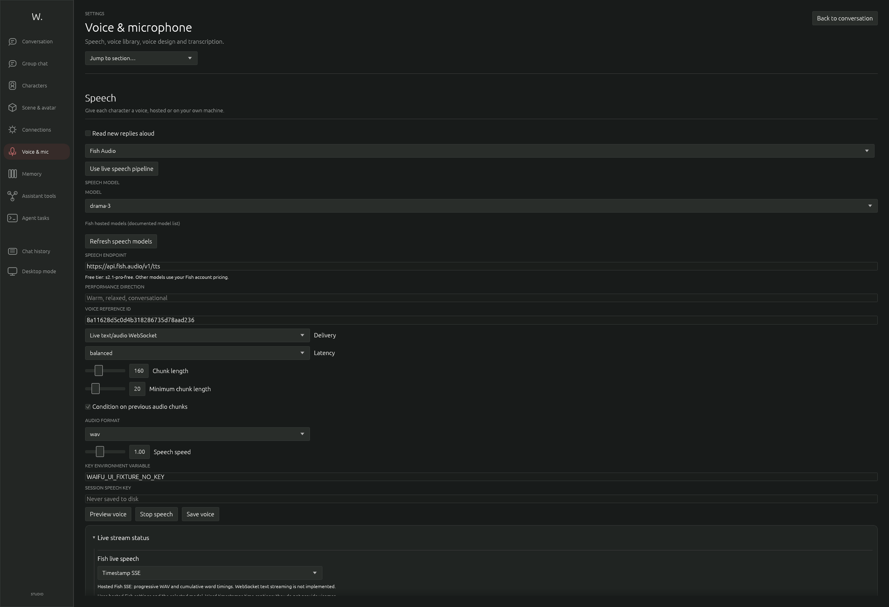
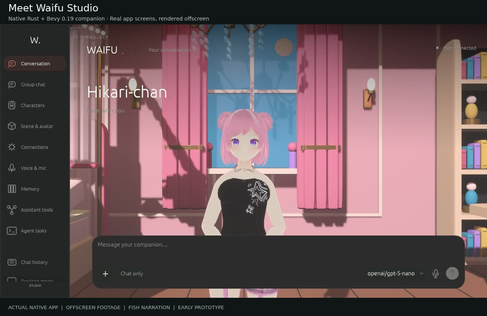

# Waifu Studio

**A native Rust + Bevy 0.19 VRM companion with chat, voice, lip-sync and a transparent desktop mode. No browser runtime required.**

Waifu Studio puts an avatar at the center of a local studio. You can import VRM characters, give each one its own persona, voice and scene, and talk to them through the chat and speech providers you choose. When you want the companion on your desktop, the same renderer can run in a transparent, topmost window.

Use the included character library or import your own models. Bring your own API keys and service accounts; credentials, model servers and coding agents are not bundled.

> [!NOTE]
> **Experimental.** Waifu Studio is a substantial native foundation, not a finished product. It is also not a complete WebWaifu4 port. It has been developed and tested on **Linux only**; macOS and Windows are unverified. Many features have code paths and automated tests but no interactive or live-provider acceptance yet. [FEATURE-STATUS.md](FEATURE-STATUS.md) gives the honest per-feature matrix.

<table>
  <tr>
    <td></td>
    <td></td>
  </tr>
  <tr>
    <td align="center"><sub>Live VRM preview beside appearance settings</sub></td>
    <td align="center"><sub>Rose bedroom: a furnished, rendered 3D room</sub></td>
  </tr>
  <tr>
    <td></td>
    <td></td>
  </tr>
  <tr>
    <td align="center"><sub>Transparent desktop mode, seated pose</sub></td>
    <td align="center"><sub>Full-page voice settings</sub></td>
  </tr>
</table>

[](product-video/waifu-studio-showcase.mp4)

**[Watch the 76-second app tour](product-video/waifu-studio-showcase.mp4)** — actual moving native renders with Fish narration; Opus 5.5 storyboard. Captured offscreen, with the seated animation explicitly presented as a pose preview. [Recording receipt](product-video/README.md).

---

## Features at a glance

**Avatars and scenes**

- Imports VRM 0.x / 1.0, GLB and glTF models. If a model replacement fails, the last visible model stays on screen.
- Offers MToon, lit/PBR and unlit rendering, outlines, and image or color backgrounds.
- Includes three simple procedural scenes and three furnished 3D rooms: Rose bedroom, Violet gaming studio and Cyan gaming lounge. The rooms are rendered geometry, not navigable worlds.
- Lets you add up to three scene companions next to the focused avatar.
- Has per-character mesh-part visibility, face and expression controls, cosine-envelope auto-blink and optional head/eye gaze with authored VRM bone or expression look-at. **Live mouth diagnostics** in the Face panel show consumed speech level and composed mouth-expression weight to help diagnose silent or blocked lip sync; these are software signals, not speaker-timing measurements.
- Imports BVH, VRMA and FBX animation, retargeted to VRM humanoids, with play/scrub/loop/speed/weight controls.
- Supports hair, skirt and accessory spring bones with VRM sphere/capsule colliders. These are joint-level springs; there is **no cloth simulation or self-collision**.
- Provides post-processing: tone mapping, exposure, color, bloom and chromatic aberration, with presets.

**Desktop mode**

- Transparent topmost window, left-drag to move, a right-click radial menu and a separate controls window for recovery.
- Bundled Homunculus idle, grabbed and sitting VRMA motions.
- Optional KDE Wayland window and taskbar detection through a temporary KWin script. It is covered by **offline fixtures only**, with no interactive compositor acceptance.

**Chat**

- Uses the OpenAI-compatible `/chat/completions` endpoint and **always streams** replies.
- Ships editable presets for Vercel AI Gateway, OpenRouter, xAI, OpenAI, Ollama, LM Studio, llama.cpp and custom servers.
- Includes a searchable model catalog, custom model IDs, optional reasoning effort and provider routing controls.
- Keeps rolling per-character history locally.
- Supports image attachments (PNG/JPEG/WebP) for vision-capable models.
- Has a scene conversation mode: serial replies from several characters, each with its own history. An explicit Jev action can suggest recipients; it does not run a general memory or animation brain.

**Voice**

- TTS through Fish Audio (hosted or local), Vercel AI Gateway and OpenAI-compatible endpoints.
- Fish supports buffered, progressive HTTP, timestamp SSE and WebSocket delivery. Fish also has a read-only voice library browser and paid Voice Design previews.
- **Playback-driven RMS lip-sync** needs no calibration. Saved zero-valued manual sliders no longer block automatic mouth movement; perceived synchronization still needs acceptance.
- Optional calibrated A/I/U/E/O vowel lip-sync takes a uLipSync JSON or wLipSync `.bin` profile that you supply. No calibration is bundled.
- Opt-in microphone capture uses energy VAD or optional Silero ONNX VAD. Transcripts go to the composer for review by default. Optional **Trim detected silence before upload** keeps 200 ms around the detected speech span and preserves pauses inside it; leave it off if VAD misses quiet speech. It reduces clip size, not the silence needed to stop recording. An optional off-by-default **Send transcript automatically** setting completes a manually started microphone → chat → reply-speech turn when the same character is selected, both the starting/current draft are empty and chat/memory are ready. Otherwise text stays for review. It never restarts the microphone or enables full-duplex listening; automatic chat/speech can incur provider charges.

**Memory, tools and agents**

- Explicit per-character notes, plus an opt-in **evidence ledger** for facts and preferences with corrections and expiry.
- Optional semantic lookup over explicit notes (default) or current accepted evidence through an embeddings endpoint. Results attach once to the matching draft; pending candidates and stale evidence are excluded.
- Optional **automatic reflection drafts** are off by default. In Memory, copy/review the reflection connection, then enable automatic sending for that character. After 3 new accepted records (configurable 1–12), it may request one cited draft with a minimum 30-minute attempt cooldown (configurable 10–1440). It pauses while a reflection awaits review; nothing is promoted to recalled memory without acceptance. Runs only for the selected character while the app is open, with no startup catch-up. Session keys are not saved; pending drafts survive restart only when candidate retention is enabled. No autonomous diary or outreach.
- Generated reflections keep structured citations. Changed/expired/forgotten sources block acceptance and recall; source corrections remove stale pending drafts. Forgetting removes linked generated reflections too. Older generated reflections without verifiable citations remain inspectable but are excluded from recall; request a fresh draft.
- Manual MCP (Streamable HTTP) tool calls with review before execution.
- Reviewed coding-agent tasks for Codex CLI, Claude Code, Pi or a custom executable, run locally or over SSH.
- A bounded, explicitly started task loop and a multi-agent task board.

## Bundled characters

On first run, the character bundle adds **22 editable VRM characters** to your library.

- **Exactly three of them** have personalities: Hikari-chan, Neuro-sama and Riko. These are the exact persona text recovered from earlier WebWaifu profiles.
- **The other 19 avatars ship with no personality prompt.** None was invented for them.

Hikari's saved Fish reference is kept, with automatic speech turned off. Riko and Neuro have original Piper bindings recorded in the bundle manifest, but the app does not run Piper yet.

Edits and deletions persist across restarts. The original VRM bytes are unchanged, and a manifest records their hashes.

> [!IMPORTANT]
> The MIT source licence does **not grant blanket redistribution rights to the character library**. These VRMs come from a private collection and retain their original authors' terms. See [model metadata](assets/characters/MODEL-METADATA.json) and the attribution notes before redistributing assets.

## Quick start

**Requirements**

- Rust **1.95+**.
- A working Vulkan driver and an X11 or Wayland session.
- `pkg-config`.
- ALSA development headers.
- The standard Bevy Linux platform development headers for X11/Wayland, such as udev, xkbcommon and the X11/Wayland client libraries.

Package names vary by distribution, so install them with your distro's own tooling.

```sh
git clone https://github.com/xsploit/waifu-studio.git   # private repo: authentication required
cd waifu-studio
./run.sh
```

The launcher builds from the pinned `Cargo.lock` using the vendored crates in `vendor/crates/`, so no extra clones or submodules are needed. **The first launch compiles the whole project and takes a while.** Later launches reuse the build.

Other launch options:

```sh
./run.sh /absolute/path/to/character.vrm          # open a specific model
./run.sh --import-folder /absolute/path/to/models # import a folder of models
./run.sh --animation /path/to/motion.bvh model.vrm
./run.sh --desktop                                # start in desktop mode
./run.sh --data-dir /path/to/separate/library     # use an isolated library
```

**First session:** open **Connections**, select a provider, enter its session key and choose a model. In **Voice & mic**, configure your speech provider and voice, preview it, then enable automatic speech if wanted. Edit the character persona in **Characters**.

**Controls:** drag to orbit, right/middle-drag to pan, scroll to zoom, and press **F** to reframe outside text fields. In desktop mode, **Escape** closes the menu first and then returns to Studio while the companion window has keyboard focus.

## Provider setup

| Purpose | Options | Key / notes |
|---|---|---|
| Chat | Vercel AI Gateway, OpenRouter, xAI, OpenAI, Ollama, LM Studio, llama.cpp, custom | `AI_GATEWAY_API_KEY`, `OPENROUTER_API_KEY`, `XAI_API_KEY`, or none for local servers |
| Speech | Fish hosted / local, Vercel AI Gateway, OpenAI-compatible | `FISH_API_KEY`, optional `FISH_REFERENCE_ID` |
| Transcription | OpenAI-compatible / local Whisper, OpenRouter, Fish ASR, Vercel | Uses the selected adapter's key |
| Embeddings | Local Ollama by default; remote endpoints need an extra opt-in | Off by default |
| Silero VAD | User-supplied `silero_vad.onnx` and native ONNX Runtime library | Optional; nothing is downloaded at build time |

**How keys are handled**

- Keys typed into the UI are kept in memory only and are never written to settings JSON.
- At startup the app also reads an optional private `credentials.env` from its data directory (normally `~/.local/share/waifu-studio` on Linux). It accepts only `AI_GATEWAY_API_KEY`, `FISH_API_KEY` and `FISH_REFERENCE_ID`.
- On Unix that file must be user-owned and mode `0600`. Process environment variables take precedence over it.

**Fish models and billing**

- New setups default to DeepSeek V4.1 Flash through Vercel, Baseten-only routing and reasoning None. Hosted speech defaults to `drama-3`, HTTP WAV streaming and Low latency; `s2.1-pro` remains selectable with the same transport settings. These use the configured providers' billing. Saved profiles retain their explicit selections.
- Unknown model names are rejected so a request can't silently fall back to a paid model.
- See [FISH-CAPABILITIES.md](FISH-CAPABILITIES.md) for the reviewed contracts and pricing references.

**Live-call coverage**

- **Fish:** authenticated hosted calls have been exercised. That covers a 25-call speech-only screen across five models and five delivery modes, plus repeated whole-pipeline and fixed-text comparisons below.
- **Vercel:** chat streaming, provider pins/order/sort, catalog checks and prerecorded transcription requests have run live. Generation lookup verified the served provider on34 observed successful requests.
- **OpenRouter:** protocol fixtures pass; live calls have not been verified.
- **ASR:** direct Fish base/Pro and Vercel Fish/Whisper accepted a prerecorded synthetic test prompt. This is not microphone or VAD acceptance.
- **Not accepted live:** perceived audio quality, speaker onset, crackle behavior, microphone endpointing, embeddings, MCP and SSH.

## Measured latency

For hosted Fish, **Voice & mic → Try HTTP low latency** applies the HTTP/Low transport tuning used in the recent pipeline tests. It keeps your selected model, voice, endpoint, speed, direction and automatic-speech choice. It stops current speech before changing delivery and sends no synthesis request. This is an explicit trial preset, not a universal fastest-mode guarantee; existing profiles are not migrated automatically. **Use live speech pipeline** selects WebSocket again for hosted Fish.

How the pipeline works: LLM text **always streams**. Fish WebSocket accepts incremental reply text directly. Buffered and HTTP WAV delivery synthesize sentence groups with bounded prefetch. Timestamp SSE also starts on sentence groups while text streams, but starts the next request only after the previous network stream and playback have finished; gaps between sentences remain possible. Word timings in the SSE panel belong to the current request and restart at zero for each sentence group.

The table shows medians of **3 samples per cell** for Send → first *decoded* audio, measured on 2026-10-18. Settings were Low reasoning, balanced Fish latency and the production 180 ms startup buffer.

| LLM | Fish model | Mode | First token | First audio |
|---|---|---|---:|---:|
| `gemini-3.5-flash` | `drama-3` | ws | 2949 ms | 3447 ms |
| `gemini-3.5-flash` | `s1` | http | 2448 ms | 3147 ms |
| `gemini-3.5-flash-lite` | `drama-3` | ws | 689 ms | 1121 ms |
| `gemini-3.5-flash-lite` | `drama-3` | http | 593 ms | 1664 ms |
| `gemini-3.5-flash-lite` | `s2.1-pro` | ws | 667 ms | 1363 ms |

Later Low-latency experiments added **DeepSeek V4.1 Flash** as an alternative. With reasoning `none`, strict Vercel `only:["baseten"]` and Drama3 WebSocket Low, five instrumented calls had medians of **359ms first text /1070ms first decoded audio**. A separate three-sample batch measured1047ms first audio. The `deepseek/deepseek-v4.1-flash-fast` suffix did not establish a speed advantage. Strict pins returned capacity429s in other batches; broader routing improves fallback options.

The recorded **Fish Pro → DeepSeek → Drama3** adapter sequence measured1623ms median from complete WAV upload to decoded reply audio (three samples). Speaking time, VAD silence delay, review-before-send and hardware latency are excluded. [Provider and ASR comparison tables](benchmarks/RESULTS.md).

**Models are explicitly selected.** These results do not make the app an automatic fastest-model selector. Regular `gemini-3.5-flash` was substantially slower than Flash Lite in these runs. Existing user profiles keep their chosen models and voice identities. The full report distinguishes the original finalist run from the later first-phrase chunking experiment.

**Caveats**

- The **500–700 ms target has not been reached.** The best repeatable medians are about 1.0–1.15 s.
- Measurements stop at decoded audio. No speaker device was opened, so device latency, audible onset and crackling are unmeasured.
- Prompts were short with no history. Some calls included cold connections, and other work ran on the machine during parts of the run.
- Three samples per cell do not establish p95 latency or a permanent winner.

[benchmarks/RESULTS.md](benchmarks/RESULTS.md) has the full tables, failures, tuning experiments, JSON receipts and reproduction commands.

## Known limitations

**Platform**

- Tested on Linux only. Other platforms are unverified.
- The coding-agent runner requires Unix process groups; Windows support is deferred.

**Desktop mode**

- Transparency, topmost and click-through behavior depend on your compositor.
- Wayland may ignore global window positioning.
- The KWin bridge has offline fixtures only.
- There are no window collisions or gravity.

**Avatar and motion**

- Spring colliders work on joints only: no cloth, mesh collision or self-collision.
- Material-expression colors and shared unrotated UV0 transforms are supported; rotated/UV1 transforms remain unsupported.
- Different exporters and rest poses may need extra retargeting calibration.
- GLB/glTF models without VRM humanoid data get no retargeting.

**Lip-sync**

- Vowel analysis is calibrated MFCC matching, not phoneme recognition.
- Perceived sync quality has not been accepted.

**Speech**

- OpenAI-compatible and Vercel speech are buffered.
- Cancellation suppresses playback immediately, but a blocked HTTP read can hold its worker slot until it times out.

**Memory**

- Fictional weekly routines can optionally inform ordinary replies; optional evidence-triggered reflection drafts require review; diary generation and proactive outreach remain unimplemented.
- Removing a profile leaves its notes and history on disk.

**Not implemented**

- VR/OpenXR and Quest.
- Body or outfit editing.
- Autonomous character-to-character dialogue.
- Fly-connectome embodiment.
- Full WebWaifu4 parity.

## Development

```sh
cargo test --all-targets
cargo clippy --all-targets -- -D warnings
cargo fmt --package waifu-studio -- --check
```

Dated test counts and exact validation commands are recorded in [VALIDATION.md](VALIDATION.md). Automated tests, strict Clippy and formatting checks are separate from interactive desktop and audio acceptance. Targeted source reviews are in [reviews/](reviews/); they are not an exhaustive audit.

To render a room preview without opening a desktop window:

```sh
cargo run --example render_rooms -- rose previews/rose-bedroom.png   # or violet / cyan
```

## Documentation

| Document | Contents |
|---|---|
| [FEATURE-STATUS.md](FEATURE-STATUS.md) | Implemented / partial / missing matrix and evidence boundaries |
| [VALIDATION.md](VALIDATION.md) | Test receipts, UI captures and what has been verified |
| [benchmarks/RESULTS.md](benchmarks/RESULTS.md) | Pipeline latency measurements and reproduction steps |
| [FISH-SETTINGS-AUDIT.md](FISH-SETTINGS-AUDIT.md) | Current Fish settings, missing controls and tested trade-offs |
| [reviews/opus-brain-integration.md](reviews/opus-brain-integration.md) | Proposed Grillo/Jev/connectome architecture; not implemented |
| [FISH-CAPABILITIES.md](FISH-CAPABILITIES.md) | Fish Audio contracts, models and pricing references |
| [LIPSYNC-NOTICES.txt](LIPSYNC-NOTICES.txt) | uLipSync / wLipSync pins, MIT notices and validation limits |
| [REFERENCES.md](REFERENCES.md) | Vendored libraries, upstream references and their licences |

## License and credits

- The **application source code** is [MIT-licensed](LICENSE).
- Vendored crates in `vendor/crates/` keep their own licences, listed in [REFERENCES.md](REFERENCES.md).
- Lip-sync algorithm notices are in [LIPSYNC-NOTICES.txt](LIPSYNC-NOTICES.txt).
- The bundled desktop motions are official **Homunculus** VRMA files, used under **CC BY 4.0** with attribution.
- The bundled illustrated backgrounds and wall-art texture are AI-generated.
- **The bundled VRM avatars are not MIT-licensed.** They come from a private collection and keep their original authors' terms. The repository does not relicense them, and the same applies to any avatars or animations you import.

Built with [Bevy](https://bevyengine.org), [bevy_egui](https://github.com/vladbat00/bevy_egui) and the vendored `bevy_vrm` / `bevy_shader_mtoon` / `serde_vrm` crates.
